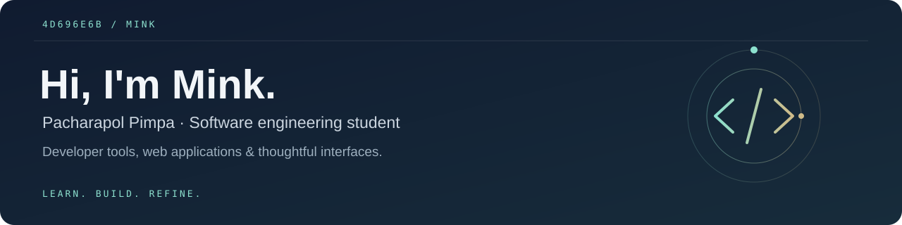

<p align="center">
  
</p>

<p align="center">
  <a href="https://pacharapol.dev"><strong>Portfolio</strong></a> &nbsp;·&nbsp;
  <a href="https://www.linkedin.com/in/pacharapol-pimpa-650a433a2/"><strong>LinkedIn</strong></a> &nbsp;·&nbsp;
  <a href="https://reposetupcli.com/"><strong>RepoSetup</strong></a>
</p>

## A little about me

I'm **Mink**, a first-year **Software Engineering student at Thammasat University, Thailand**. I enjoy turning setup friction and everyday problems into tools I can use, test, and keep improving.

My interests span developer tooling, full-stack web development, and IoT. I'm looking for a **software engineering internship** where I can contribute, learn from code reviews, and build experience working with a team.

## Selected work

### 01 / [RepoSetup](https://github.com/4d696e6b/RepoSetup)
**Compose a development stack from the terminal.**

An open-source CLI for planning and configuring supported JavaScript/TypeScript and Python stacks. It includes compatibility checks, dry-run previews, project detection, and health checks, with a companion website for exploring tools and preparing selections.

**Published release: [v0.3.1](https://github.com/4d696e6b/RepoSetup/releases/tag/v0.3.1)** · npm package: [`rsetup`](https://www.npmjs.com/package/rsetup) · Node.js 24+

```sh
npx rsetup@0.3.1 --help
```

Early-stage tooling: integration maturity and platform coverage vary. The [release notes](https://github.com/4d696e6b/RepoSetup/releases/tag/v0.3.1) document the tested scope and remaining limits.

[Explore the website →](https://reposetupcli.com/)

---

### 02 / [Luxios](https://github.com/4d696e6b/luxios)
**A quieter workspace, with a little gold.**

A dark VS Code theme family with deep navy surfaces, champagne-gold accents, and syntax styling for TypeScript, React, and Python. Four variants: Luxios, Midnight, OLED, and Royale.

**Published release: [v0.1.6](https://github.com/4d696e6b/luxios/releases/tag/v0.1.6)** · VS Code themes · MIT

[View on the Marketplace →](https://marketplace.visualstudio.com/items?itemName=4d696e6b.luxios)

---

### 03 / [GraphicRouter](https://github.com/4d696e6b/GraphicRouter)
**From a rough brief to an editable visual story.**

A project exploring structured infographic and presentation workflows inside ChatGPT, with individually composed text and shapes, focused revisions, and PowerPoint export.

**Development prototype** · TypeScript · Presentation tooling

The ChatGPT app remains in Development mode; installation from a separate customer account is not yet verified. See the [project's current scope](https://github.com/4d696e6b/GraphicRouter#current-limits-and-verification).

## Languages & tools

**Programming languages**

<p>
  
  
  
</p>

**Web development**

<p>
  
  
  
  
  
</p>

**Development workflow**

<p>
  
  
  
</p>

I use projects to deepen these skills, from interface details to testing and release documentation.

## GitHub activity

<p>
  <a href="https://github.com/4d696e6b?tab=repositories">
    
  </a>
</p>
<p>
  <a href="https://github.com/4d696e6b?tab=repositories">
    
  </a>
</p>

<sub>Language statistics reflect repository code, not skill proficiency. Cards are provided by GitHub Readme Stats.</sub>

## Let's connect

I'm interested in internship opportunities and conversations about developer tools and useful web applications.

[LinkedIn](https://www.linkedin.com/in/pacharapol-pimpa-650a433a2/) · [Portfolio](https://pacharapol.dev)

<sub>A small detail: `4d696e6b` is “Mink” encoded in hexadecimal.</sub>
